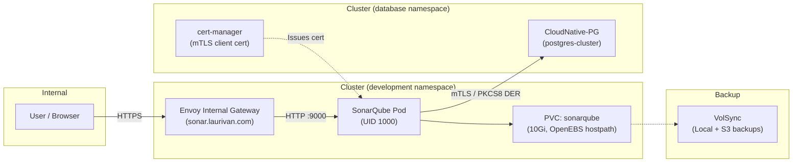

# SonarQube

SonarQube Community Build running at [https://sonar.laurivan.com](https://sonar.laurivan.com) (and [https://sonarqube.laurivan.com](https://sonarqube.laurivan.com)).

## Architecture



## Overview

- **Namespace**: `development`
- **Chart**: `bjw-s/app-template` v5.0.1
- **Database**: CloudNative-PG PostgreSQL (`postgres-cluster`) in `database` namespace
  - Authenticates via mTLS client certificates (`cert clientcert=verify-full`)
  - Client certificate private key is converted from PEM to PKCS#8 DER format at pod initialization for PostgreSQL JDBC driver compatibility
- **Persistence**:
  - `sonarqube` PVC (10Gi, `openebs-hostpath`) mounted at `/opt/sonarqube/data`
  - Ephemeral extensions directory at `/opt/sonarqube/extensions`
  - Backed up via VolSync (local NFS repository + remote S3 replication)
- **Ingress**:
  - Gateway API `HTTPRoute` via `envoy-internal`
  - Hostnames: `sonar.laurivan.com`, `sonarqube.laurivan.com`
  - Homepage dashboard integration

## Credentials & Secrets

### Initial Web Credentials
- **Username**: `admin`
- **Password**: `admin`
- On first login, SonarQube prompts you to change the administrator password.

### Kubernetes Secrets

| Secret Name | Managed By | Description |
| ----------- | ---------- | ----------- |
| `postgres-sonarqube-cert` | `cert-manager` | Client mTLS certificate issued by `postgres-cluster-client-ca-issuer`. Mounted at `/var/run/secrets/postgresql/` and converted to `/opt/sonarqube/certs/tls.pk8` by the `init` container. |
| `sonarqube-postgres` | Flux component (`components/cnpg/app`) | Contains connection parameters generated by the CNPG app component. |
| `sonarqube-volsync-secret` | `external-secrets` | Extracted from Bitwarden (`volsync_template`) for local Kopia backups. |
| `sonarqube-volsync-s3-secret` | `external-secrets` | Extracted from Bitwarden (`volsync_s3_template`) for remote S3 backups. |

> [!NOTE]
> No manual secrets or passwords are required for the database connection; authentication is fully automated via mTLS client certificates.

### Administration & Troubleshooting

- **Admin Password Reset**:
  If the `admin` password is lost, you can generate a hash and update PostgreSQL directly:
  ```bash
  # Generate bcrypt hash (e.g. for a new password)
  # Update the users table in the database:
  kubectl exec -n database postgres-cluster-1 -c postgres -- psql -U postgres -d sonarqube \
    -c "UPDATE users SET crypted_password = '<hash>', salt = null, hash_method = 'BCRYPT' WHERE login = 'admin';"
  ```
