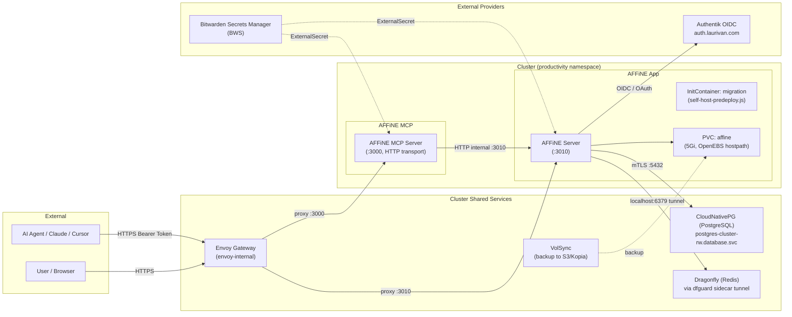

# AFFiNE & AFFiNE MCP Server

Self-hosted knowledge base and workspace combining documents, whiteboards, and multimodal AI capabilities, accessible at [https://affine.laurivan.com](https://affine.laurivan.com).

Also includes a companion **Model Context Protocol (MCP)** server at [https://affine-mcp.laurivan.com](https://affine-mcp.laurivan.com) to allow AI agents (Claude Desktop, Cursor, Antigravity) to query and manage workspaces and documents over MCP.

---

## Architecture



---

## Components

| Component | Image | Purpose |
|:---|:---|:---|
| **AFFiNE Server** | `ghcr.io/toeverything/affine:stable` | Primary collaborative workspace application (docs, whiteboards, tables) |
| **AFFiNE MCP Server** | `ghcr.io/dawncr0w/affine-mcp-server:latest` | Model Context Protocol adapter enabling AI assistants to interact with AFFiNE via HTTP |
| **PostgreSQL** | CloudNativePG (`postgres-cluster`) | Relational database backend with vector extensions (`vchord`, `vector`) |
| **Dragonfly** | Dragonfly (`dfguard` tunnel) | Redis-compatible distributed cache and session store |
| **VolSync** | VolSync (`openebs-hostpath`) | Continuous volume snapshots and offsite backups |

---

## Endpoints

| Service | Protocol | Hostname | Gateway | Port | Auth Mode |
|:---|:---|:---|:---|:---|:---|
| **AFFiNE Web UI & API** | HTTPS | `affine.laurivan.com` | envoy-internal | 443 -> 3010 | Authentik OIDC only (Guest read-only) |
| **AFFiNE MCP Server** | HTTPS | `affine-mcp.laurivan.com` | envoy-internal | 443 -> 3000 | Bearer token (`AFFINE_MCP_HTTP_TOKEN`) |

---

## Authentication & Access Control

AFFiNE is configured in **OIDC-only mode with read-only guest access**:
* **Guest / Unauthenticated Mode:** `flags.allowGuestDemoWorkspace: false`. Visitors without an authenticated session cannot create or edit workspaces. Public shared pages remain read-only.
* **OIDC-Only Authentication:** `auth.allowSignup: false` and `auth.allowSignupForOauth: true`. Local password and magic-link signups/logins are disabled. Only accounts authenticated via Authentik OIDC are allowed.
* **Issuer URL:** `https://auth.laurivan.com/application/o/affine/`
* **Redirect URI:** `https://affine.laurivan.com/oauth/callback`
* **Scopes:** `openid profile email`

### Authentik Setup Instructions

1. Log into your Authentik Admin interface at [https://auth.laurivan.com](https://auth.laurivan.com).
2. Go to **Customization -> Property Mappings** and verify / create a Scope Mapping for email verification:
   * **Scope name:** `email`
   * **Name:** `authentik affine OAuth Mapping: OpenID 'email'`
   * **Expression:**
     ```python
     return {
         "email": request.user.email,
         "email_verified": True
     }
     ```
   *(Note: AFFiNE strictly checks `email_verified: true` in the OIDC claims. Authentik's built-in default mapping returns `email_verified: False`, which causes AFFiNE to reject logins with "Email for this account is not verified").*
3. Go to **Applications -> Providers** and configure the `AFFiNE` provider:
   * **Type:** `OAuth2/OpenID Provider`
   * **Name:** `AFFiNE`
   * **Client type:** `Confidential`
   * **Client ID:** *(Copy to Bitwarden `AFFINE_OIDC_CLIENT_ID`)*
   * **Client Secret:** *(Copy to Bitwarden `AFFINE_OIDC_CLIENT_SECRET`)*
   * **Redirect URIs:** `https://affine.laurivan.com/oauth/callback`
   * **Signing Key:** Select your Authentik signing certificate
   * **Scopes:** Select `openid`, `profile`, and `authentik affine OAuth Mapping: OpenID 'email'` (ensure default email mapping is unchecked)
   * **Subject mode:** `Based on the User's Email` (or username)
4. Go to **Applications -> Applications** and configure the `AFFiNE` application:
   * **Name:** `AFFiNE`
   * **Slug:** `affine`
   * **Provider:** Select the `AFFiNE` provider created in the previous step
   * **Launch URL:** `https://affine.laurivan.com`

---

## AI & LLM Integration (Bring Your Own Key - BYOK)

AFFiNE includes Copilot capabilities (writing assistant, summarization, action items, image generation) powered by **AI BYOK**:

* **Server Configuration:** `copilot.enabled: true` with `copilot.byok.enabled: true`, `allowCustomEndpoint: true`, and `allowPrivateEndpoint: true`.
* **Connecting an LLM:**
  1. Navigate to `https://affine.laurivan.com` and log in.
  2. Open **Workspace Settings** (gear icon or workspace dropdown) → **Integrations** → **AI BYOK**.
  3. Click **Add key** (or **Connect AI provider**).
  4. Select a provider:
     - **OpenAI** (or custom OpenAI-compatible endpoint like Ollama, LocalAI, OpenRouter, vLLM, Groq, DeepSeek).
     - **Anthropic** (Claude).
     - **Google Gemini**.
     - **Fal.ai** (for image generation).
  5. Enter your API key (and custom endpoint URL if using Ollama or another self-hosted model).
  6. Choose storage scope: **Server key** (shared across workspace members) or **Local key** (device only).
  7. Select desired models and capabilities, click **Test connection**, and save.

---

## Secrets Management (Bitwarden)

Secrets are synchronized directly from **Bitwarden Secrets Manager (BWS)** using the External Secrets Operator (`ClusterSecretStore: bitwarden`).

### 1. Item: `affine`

Create a secret in Bitwarden named **`affine`** containing the following JSON payload:

```json
{
  "AFFINE_ADMIN_EMAIL": "laur@laurivan.com",
  "AFFINE_ADMIN_PASSWORD": "<generate-secure-admin-password>",
  "AFFINE_SERVER_EXTERNAL_URL": "https://affine.laurivan.com",
  "AFFINE_OIDC_CLIENT_ID": "<client-id-from-authentik>",
  "AFFINE_OIDC_CLIENT_SECRET": "<client-secret-from-authentik>",
  "AFFINE_OIDC_ISSUER": "https://auth.laurivan.com/application/o/affine/"
}
```

*The ExternalSecret automatically compiles this data into `/root/.affine/config/config.json` inside the container.*

### 2. Item: `affine-mcp`

Create a second secret in Bitwarden named **`affine-mcp`** containing the following JSON payload:

```json
{
  "AFFINE_EMAIL": "laur@laurivan.com",
  "AFFINE_PASSWORD": "<password-matching-affine-account>",
  "AFFINE_MCP_HTTP_TOKEN": "<generate-a-strong-secret-token-for-mcp-clients>"
}
```

---

## Connecting AI Clients to AFFiNE MCP

To configure Claude Desktop, Cursor, Antigravity, or other MCP clients to interact with your AFFiNE server:

```json
{
  "mcpServers": {
    "affine": {
      "url": "https://affine-mcp.laurivan.com/mcp",
      "headers": {
        "Authorization": "Bearer <YOUR_AFFINE_MCP_HTTP_TOKEN>"
      }
    }
  }
}
```

---

## Flux Kustomizations

| Name | Path | Depends On |
|:---|:---|:---|
| `affine` | `./kubernetes/apps/productivity/affine/app` | `postgres-cluster`, `dragonfly-cluster`, `volsync` |
| `affine-mcp` | `./kubernetes/apps/productivity/affine/mcp` | `affine` |
